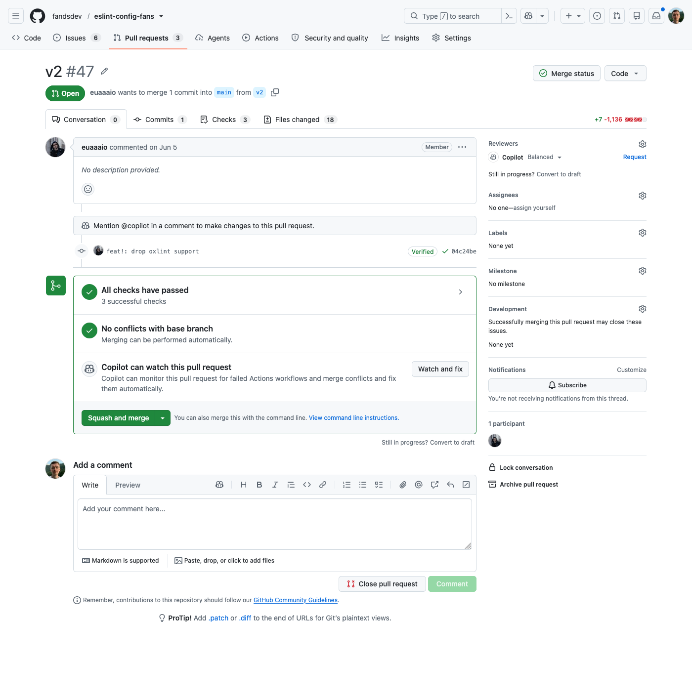
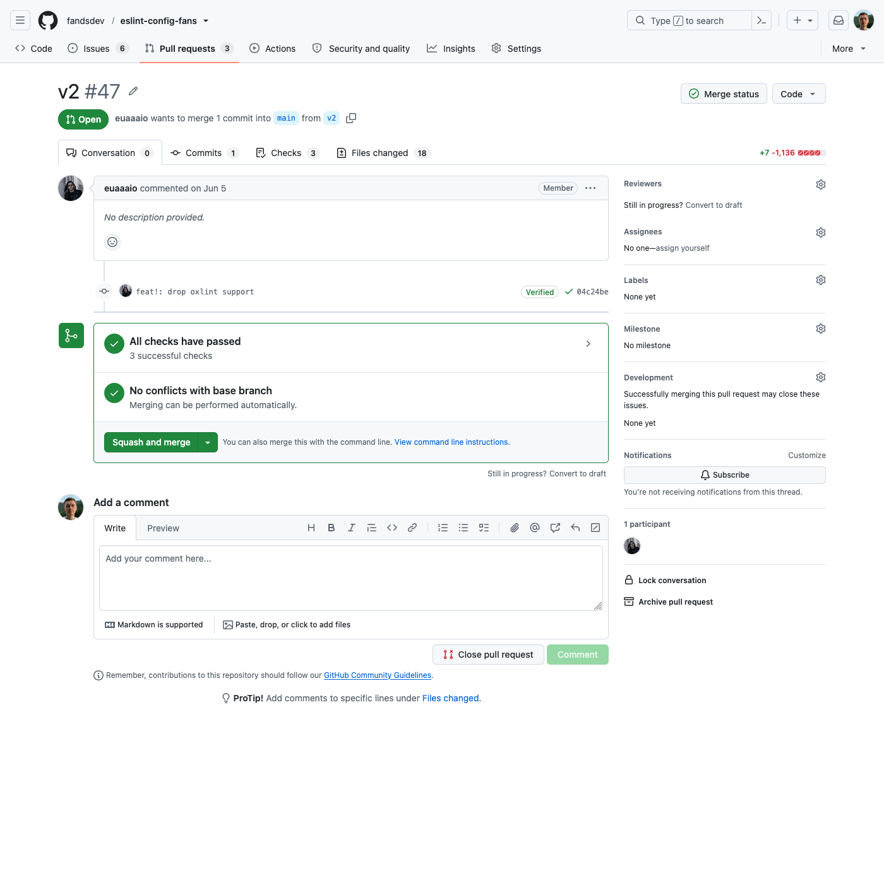

#  GitHub Deslop

A Firefox extension that hides Copilot and other clutter from github.com.

| Before | After |
| --- | --- |
|  |  |

## What it hides

Each item can be switched off on the options page.

- **Copilot and agents**
  - Header: Copilot button and menu, Agents tab, New agent session in «+».
  - Pull requests: merge box, reviewer sidebar and picker, comment toolbar, Copilot panel and Ask about this diff on Files changed, New agent session on the list.
  - Files: Ask Copilot, New agent session, Add to space, Copilot group in «…».
- **Codespaces**: New codespace in «+».
- **Enterprise upsells**: Try Enterprise in the user menu.
- **Notifications badge** on the inbox icon.
- **Org icon** in the breadcrumbs and repo title.
- **All issues / All PRs / All repos** buttons in the header.

## Install

Install it from [addons.mozilla.org](https://addons.mozilla.org/firefox/addon/github-deslop/), or download the `.xpi` from the [latest release](https://github.com/f213/github-deslop/releases/latest) and open it in Firefox. Firefox 142 or newer is required.

Chrome, Edge and other Chromium browsers 148 or newer run `extension/` as is, since Chromium 148 added the `browser.*` namespace. Clone this repo, open `chrome://extensions` (`edge://extensions` in Edge), turn on Developer mode, click Load unpacked and pick the `extension/` folder. To update, run `git pull` and press Reload on the extension's card.

## Development

```sh
npm ci
npm run login        # sign the test Firefox profile into GitHub, once
npm run dev          # run Firefox with the extension loaded from extension/
npm run check        # check every rule against live GitHub pages, screenshots go to artifacts/
npm run probe -- <url> <selector>  # print the DOM GitHub renders for a selector
npm run screenshots  # retake docs/before.png and docs/after.png
```

Every rule in `extension/content.css` has a target in `scripts/targets.js` that must be hidden with the setting on and visible with it off, next to a neighbour that must stay visible either way.

## Releasing

Bump `version` in `extension/manifest.json` and push to `master`. The Release workflow submits the extension to its [AMO listing](https://addons.mozilla.org/firefox/addon/github-deslop/), waits for review and attaches the `.xpi` to a `v<version>` GitHub release. Until review passes, that release is a prerelease carrying `github-deslop-dev-<version>.xpi`, an unlisted "GitHub Deslop (dev)" add-on that AMO signs without review.

## License

[MIT](LICENSE)
