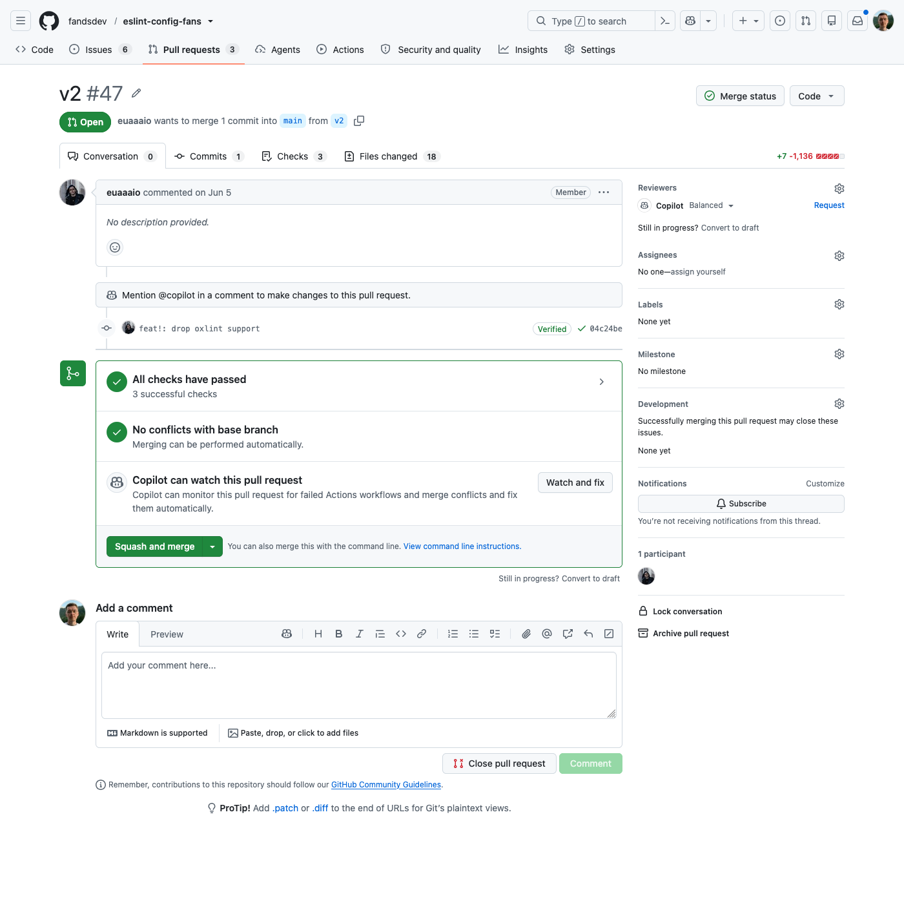
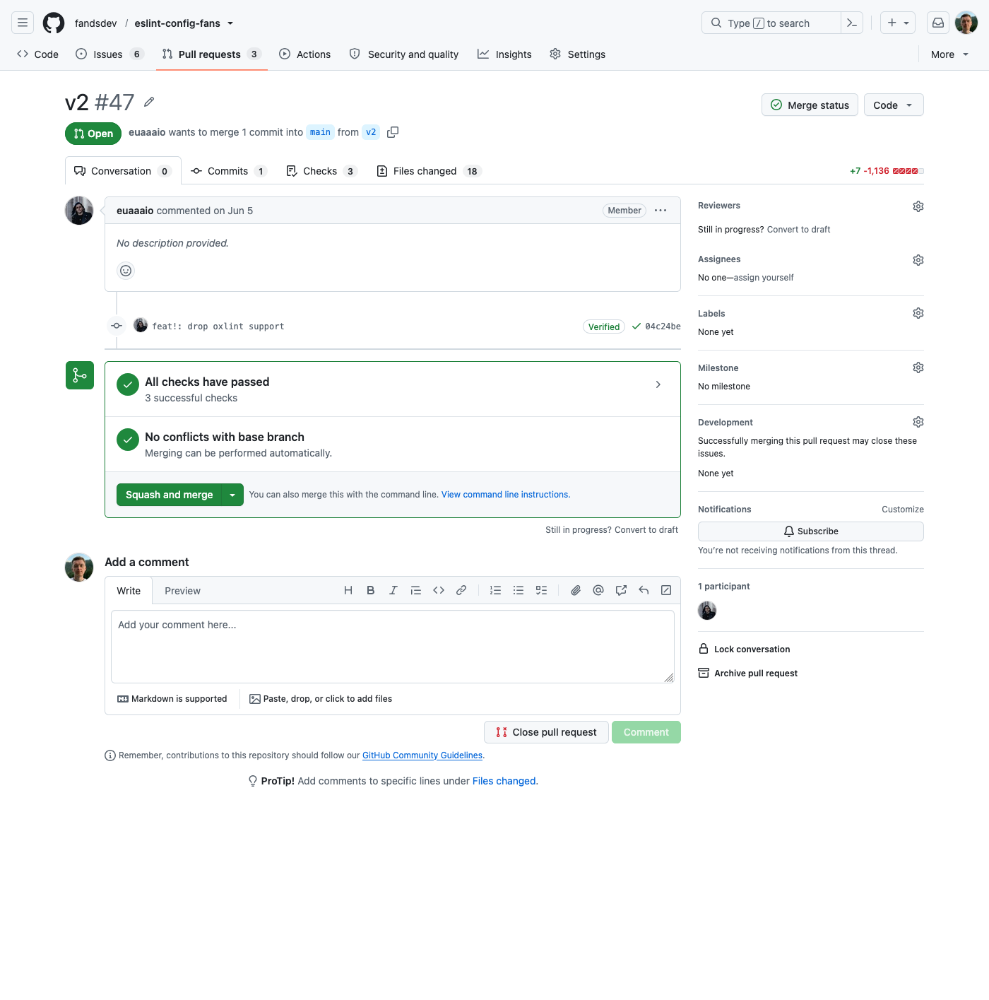

#  GitHub Deslop

A Firefox extension that hides Copilot and other clutter from github.com.

| Before | After |
| --- | --- |
|  |  |

## What it hides

Each item can be switched off on the extension's options page.

- **Copilot mentions**: the header Copilot button and menu, the Agents tab, the Copilot panel toggle and the per-file "Ask about this diff" button on Files changed, Copilot in the merge box, the reviewer sidebar and picker, the comment toolbar and the menus.
- **The new notifications badge** on the inbox icon.
- **The org icon** in the breadcrumbs and the repo title.
- **The All issues / All PRs / All repos buttons** in the header.

## Install

Install it from [addons.mozilla.org](https://addons.mozilla.org/firefox/addon/github-deslop/), or download the `.xpi` from the [latest release](https://github.com/f213/github-deslop/releases/latest) and open it in Firefox. Firefox 142 or newer is required.

## Development

```sh
npm ci
npm run login        # sign the test Firefox profile into GitHub, once
npm run dev          # run Firefox with the extension loaded from extension/
npm run check        # check every rule against live GitHub pages, screenshots go to artifacts/
npm run probe -- <url> <selector>  # print the DOM GitHub renders for a selector
npm run screenshots  # retake docs/before.png and docs/after.png
```

Every rule in `extension/content.css` has a target in `scripts/targets.js` that must be hidden with the setting on and visible with it off, next to a neighbour that must stay visible either way.

## Releasing

Bump `version` in `extension/manifest.json` and push to `main`. The Release workflow submits the extension to its [AMO listing](https://addons.mozilla.org/firefox/addon/github-deslop/), waits for review and attaches the `.xpi` to a `v<version>` GitHub release.

## License

[MIT](LICENSE)
